  

  <a href="https://sahil-pal-portfolio-d147.vercel.app/"><strong>🌐 Portfolio</strong></a> &nbsp;&nbsp;•&nbsp;&nbsp;
  <a href="https://linkedin.com/in/sahiilpal"><strong>💼 LinkedIn</strong></a> &nbsp;&nbsp;•&nbsp;&nbsp;
  <a href="mailto:sahil.sp.sp.2003@gmail.com"><strong>✉️ Email</strong></a> &nbsp;&nbsp;•&nbsp;&nbsp;
  <a href="https://github.com/saahilpal/hush"><strong>⚡ Latest Project: Hush</strong></a>

 

### 👋 The Short Version

I'm a software engineer based in **Bengaluru, India**, specializing in **AI systems**, **context architecture**, and **edge infrastructure**.

Most AI tooling today is probabilistic guessing stacked on top of more guessing. I prefer building the **deterministic spine underneath**: git-aware AST symbol indexers, bounded execution repair loops, and privacy-first edge services designed to run indefinitely on serverless free tiers.

When I'm not writing code, I'm usually studying compiler frontends, playing chess, or designing local developer tools.

---

### 🚀 Featured Systems

#### ⚡ [Synapse](https://github.com/saahilpal/synapse)
> **The Deterministic Context Injector for AI Coding Agents**  
> `Python` • `Tree-sitter` • `SQLite FTS5` • `Model Context Protocol (MCP)`
> 
> A Git-aware background daemon that indexes repositories into AST symbol hierarchies and dependency graphs. Combines vector similarity with SQLite FTS5 keyword indexing to feed bounded, deterministic context to LLM coding agents.
> 
> [Explore Synapse →](https://github.com/saahilpal/synapse)

#### 🤫 [Hush](https://github.com/saahilpal/hush)
> **Private, Free-Tier Email Open &amp; Click Tracker**  
> `Cloudflare Workers` • `Cloudflare D1` • `Chrome MV3` • `Vanilla JS`
> 
> Invisible 1x1 transparent tracking pixel with zero watermarks and zero stored IP addresses/user agents. Features a **4-tier sender immunity engine** (Client DOM shield, session cookie, sender IP matching, and DoH MX verification) to eliminate false opens when senders view their sent mail. Runs 100% on Cloudflare's free tier.
> 
> [Explore Hush →](https://github.com/saahilpal/hush)

#### 🛡️ [Patchbound](https://github.com/saahilpal/patchbound)
> **Bounded AI Repair Engine &amp; Trust Boundaries**  
> `Python` • `AST Analysis` • `Cryptographic Verification` • `AI Safety`
> 
> Deterministic trust boundaries for autonomous code repair loops. Uses Synapse AST structural retrieval and cryptographic test assertions to verify patches before runtime deployment.
> 
> [Explore Patchbound →](https://github.com/saahilpal/patchbound)

#### 📄 [RAG Doc Analyzer](https://github.com/saahilpal/RAG-DOCAnalyzer)
> **Stateless Document Q&amp;A with Grounded Retrieval**  
> `Next.js` • `pgvector` • `PostgreSQL` • `Gemini API` • `SSE Streaming`
> 
> Production-grade RAG pipeline combining Gemini embeddings, `pgvector` cosine similarity, and PostgreSQL full-text search. Features async ingestion worker queues and Server-Sent Events (SSE) streaming.
> 
> [Explore RAG Doc Analyzer →](https://github.com/saahilpal/RAG-DOCAnalyzer)

#### 🔄 [LeetSync](https://github.com/saahilpal/LeetSync)
> **Automated Problem &amp; Complexity Archival Engine**  
> `TypeScript` • `Chrome Extension (MV3)` • `Vite` • `GitHub API`
> 
> Manifest V3 Chrome extension that captures LeetCode problem solutions, extracts time/space complexity metadata, and syncs structured Markdown notes directly to GitHub repositories via the GitHub Contents API.
> 
> [Explore LeetSync →](https://github.com/saahilpal/LeetSync)

---

### 🧠 Core Engineering Principles

* **Deterministic Spine, Probabilistic Leaves** — LLMs excel at synthesis and creative reasoning, but break when guessing repository structure. Provide them with deterministic AST symbols, types, and boundaries first.
* **Free-Tier Sovereign** — Great software shouldn't require heavy cloud bills. I architect systems that operate efficiently inside edge free limits (Cloudflare Workers, D1, Supabase, Vercel) through sub-millisecond execution and batching.
* **Zero Telemetry Sprawl** — Respect privacy by default. Tools like Hush store zero IP addresses, zero user agents, and attach zero tracking watermarks to outgoing emails.
* **Code is for Humans First** — Simple, legible abstractions with minimal external dependencies beat clever over-engineering every time.

---

### 🛠️ Technical Arsenal

| Domain | Primary Tools &amp; Primitives |
|:---|:---|
| **AI Systems &amp; Context** | Model Context Protocol (MCP), Tree-sitter AST, Gemini API, RAG, pgvector, Semantic Search |
| **Languages &amp; Runtimes** | TypeScript, Python, Node.js, Java 17 (Vert.x), React, Next.js, Go |
| **Databases &amp; Storage** | Cloudflare D1, SQLite (FTS5 / WAL), PostgreSQL, Redis, MongoDB |
| **Edge &amp; Infrastructure** | Cloudflare Workers, Chrome Extensions (MV3), Docker, Git Internals, Linux |

---

### 📖 Currently Exploring &amp; Tinkering

* **Local Code Models &amp; Quantization** — Running low-latency AST-guided code completions locally via `llama.cpp`.
* **Distributed Consensus &amp; Edge DBs** — WAL replication semantics and single-digit ms edge storage with Cloudflare D1.
* **Chess Engines &amp; Tree Traversal** — Minimax variations, alpha-beta pruning, and position evaluation heuristics.

---

  
  &nbsp;&nbsp;
  

  Crafted with care • Built for clarity, performance, and deterministic systems

